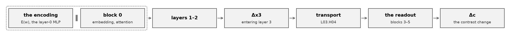
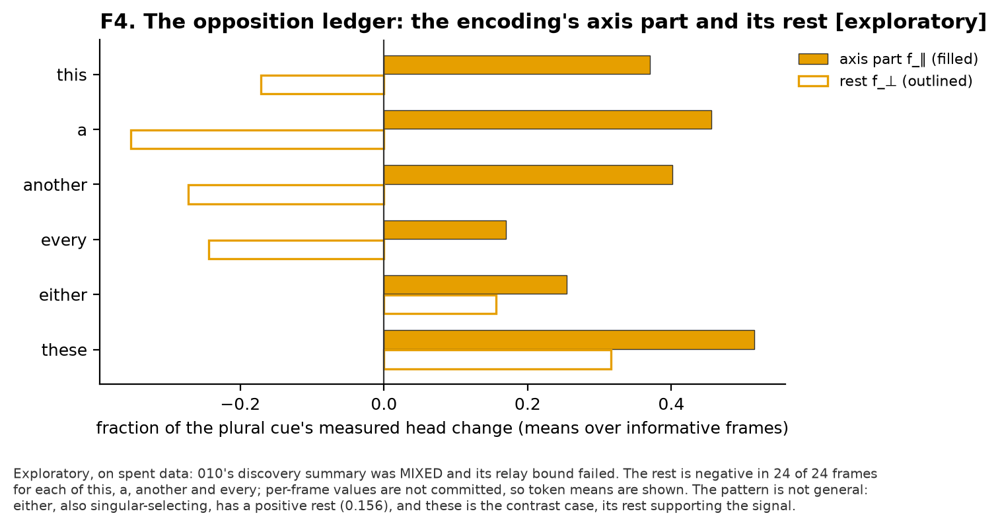
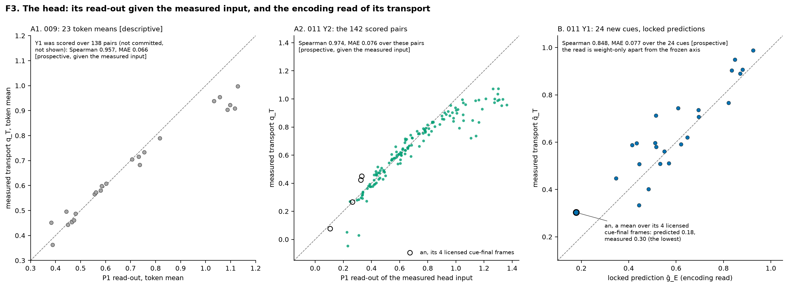
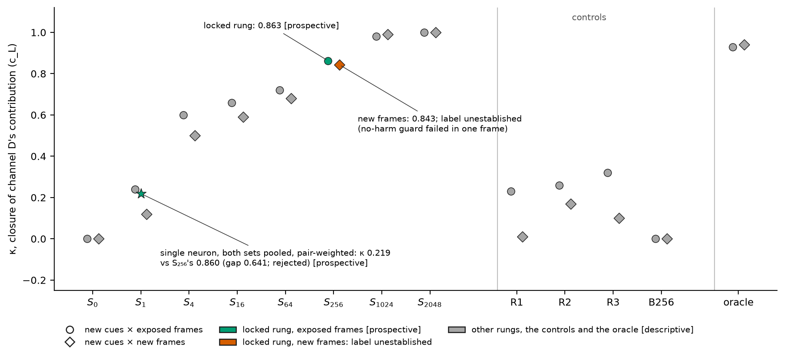
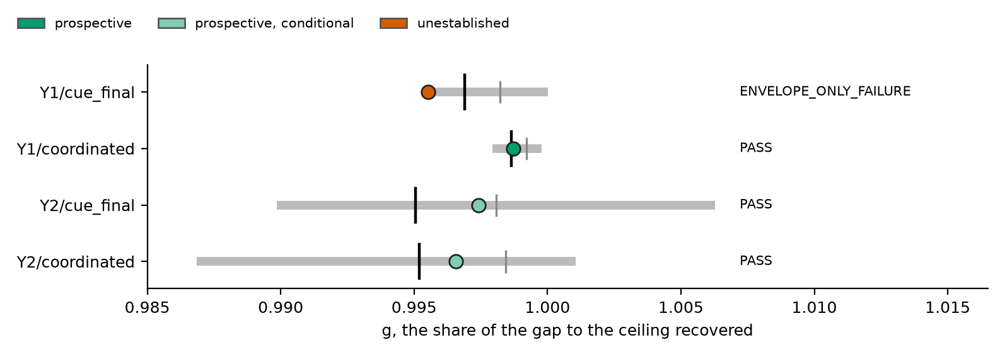
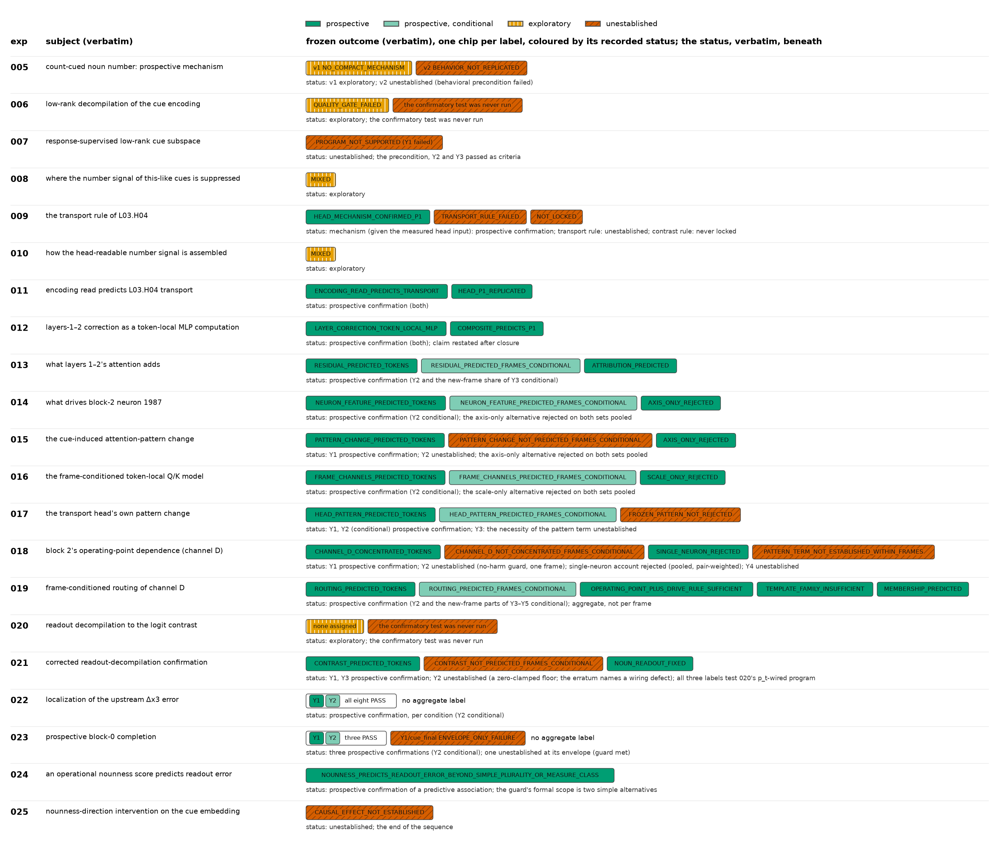
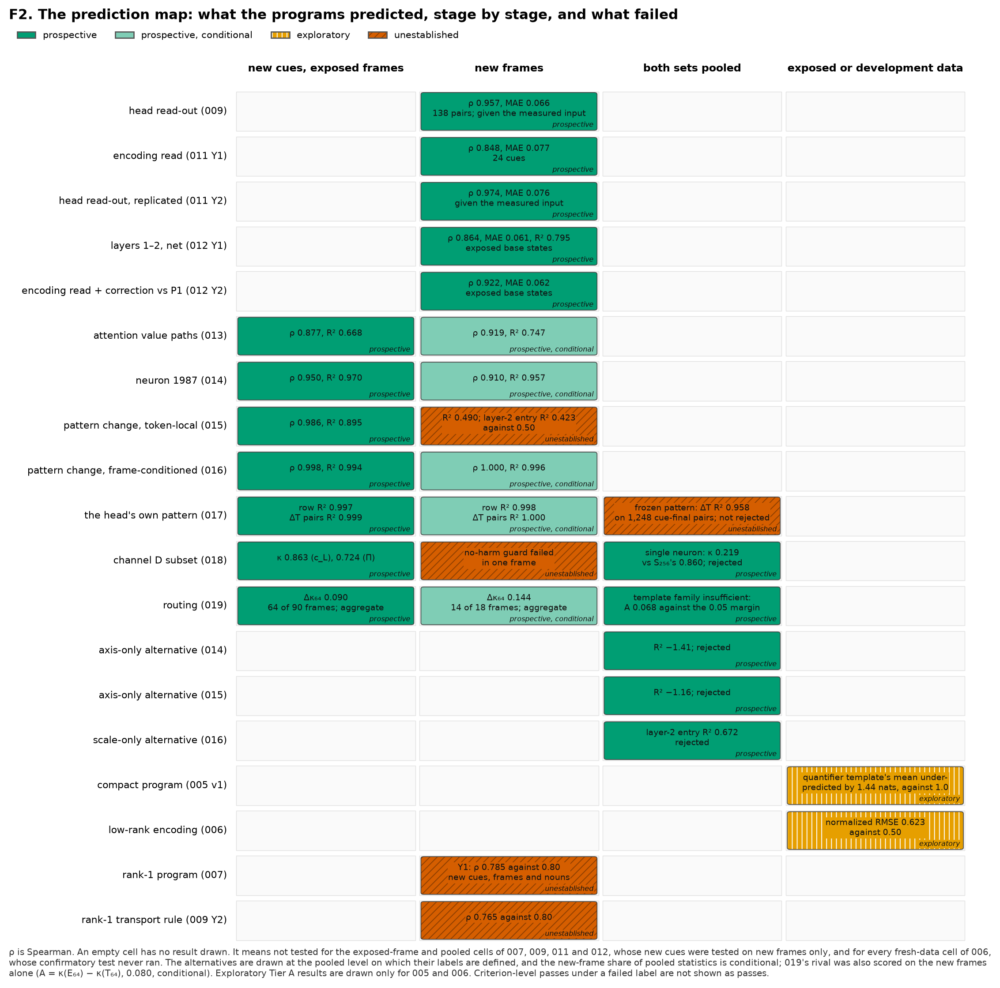
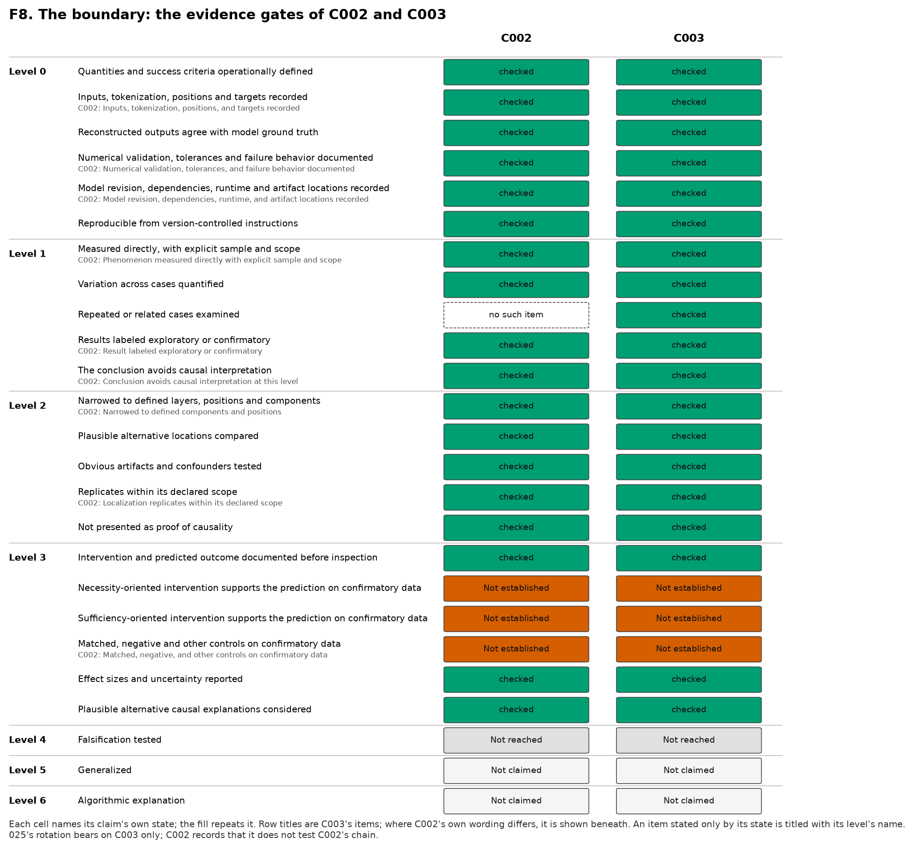
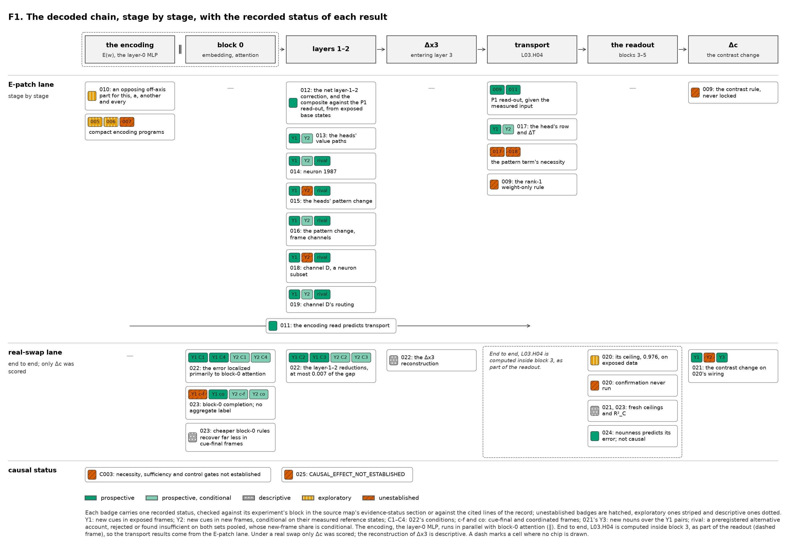

# Prospectively Predictive Programs for a Naturally Learned Computation: Count-Cued Noun Number in Pythia-70M

**Draft v3, 2026-09-30. Internal; not for circulation.** It restructures [draft v2](draft-v2-2026-09-30.md), revision 1,
for TMLR, following the outline of the paper-level review as the reviewer adopted it on 2026-09-30, and applies the
reviews of its first build ([reviews](reviews.md)). A page-count build in the TMLR template
([tmlr-build](tmlr-build/README.md)) put the main text at about 13.4 pages with Figure 6 in §7 and about 12.3 with it in
Appendix C, where it now is, as the reviewer's rule of 2026-09-30 directs. Since 2026-10-01 the build sets the
references from BibTeX and uses print variants of the figures whose text would print too small; §2 now cites the model
and the library. It adds no claim and no number that the record does not state; the statements that rest on the record
keep their traces as hidden comments (Appendix D). On 2026-10-01 the statement on AI tools was replaced by the one that
the [AI-use audit](ai-use-audit-2026-10-01.md) derived from the record and the author's answers, after an independent
check of its wording, and §3 now says who reviewed at each gate. The submission PDF is compiled with pdfLaTeX; what the
submission still needs is in the [submission checklist](tmlr-build/submission-checklist.md).

## Abstract

We ask whether the computation by which a pretrained transformer turns a count cue into the choice between a singular
and a plural noun can be recovered as an explicit, compact, human-readable causal mechanism, specified before it is
tested on examples and interventions it was not built from. In pinned Pythia-70M-deduped we ran 21 experiments, most of
them preregistered single-run tests: stages of a candidate mechanism were formulated on exposed data, frozen as programs
and tested once each; every failure was kept, and the composite account was assembled afterwards. On exploratory and
calibration data, for two cue pairs in three screening templates, the singular-versus-plural contrast is localized to
the layer-0 MLP at the cue position, the attention head `L03.H04` and the layer-4 and layer-5 MLPs; its one
preregistered confirmation failed its behavioral precondition. Stage programs written from three inputs (the weights,
each frame's measured reference state, and quantities locked from exposed data) then predicted, by rules frozen before
the target prompts were executed, the consequences of an intervention on the cue's layer-0 encoding, stage by stage up
to the head's output, for new cues from the tested lexical classes, and in new frames for most stages, from experiment
013 on conditional on the frames' measured reference states. Under real cue swaps, with block 0 completed, three
conditions for new determiner-like, quantity and adjective cues passed relative to the readout's own ceiling (new frames
conditional), and one was an `ENVELOPE_ONLY_FAILURE`; there is no aggregate label. Much of this accuracy may come from
exact computation given the measured reference state. Against the question: explicit and specified before testing,
largely; compact and human-readable, in parts only; tested on interventions it was not built from, only partly; runnable
without the network, no; causal, not established. Of four preregistered routes to causal status, three concerned the
localized components and one a decoded direction; three ran, and none established it. The programs are prospectively
predictive; their causal gates are unestablished.

**Use of AI tools.** *(In the TMLR build, a first-page footnote.)* Generative AI tools were used extensively in this
work: Anthropic's Claude, through the Claude Code agent, and OpenAI's Codex and ChatGPT. The authors chose the research
problem and the main directions of the work, and approved the behavior studied, which an AI-run screening proposed. AI
assistants proposed the experimental designs and the options among them. ChatGPT, which the authors consulted as a
reviewer, proposed the decisions that the project's records give to its reviewer: design approvals and changes, lock
sign-offs, claim registrations, and the decision to write this paper, its venue and the framing of its contributions.
The authors chose among the options, decided which proposals to adopt, and committed or authorized each preregistration
lock before its confirmation run. Codex implemented the first experiments, which this paper does not report, and the
instrumentation package that the later ones use, and it drafted the design of the behavior screening. AI assistants
drafted the research methodology and its evidence ladder, the designs, preregistrations and decision rules; wrote the
analysis code and tests; ran every phase of every experiment, including each single preregistered confirmation run,
under protocols fixed before each run (Table A2 lists the amendments); performed the literature searches, reading the
sources partly through a page-summarizing tool; drafted the experiment reports and their interpretations, the claim
records, the cross-experiment synthesis, the figures and this manuscript; and ran the exploratory diagnostics and design
spikes that preceded later designs. Separate read-only instances of Claude, which wrote most of the code and ran the
experiments, reviewed the implementations, freezes, calibrations, locks and confirmations (with committed records from
Experiment 023 on), the claim records, the synthesis, the literature review, the figures and every draft. These reviews
and assistant-written scripts checked every reported number against the committed experimental record and every
bibliographic record against its source; the paraphrases of the key prior works were spot-checked. The authors take full
responsibility for the manuscript<!-- (research/paper/ai-use-audit-2026-10-01.md@5ce4d60:280–292, 298–317) -->.

## 1. Introduction

Circuits in language models are found by path patching and its automated variants, and evaluated by causal abstraction,
interchange interventions and causal scrubbing (Wang et al., 2023; Conmy et al., 2023; Geiger et al., 2021, 2024; Chan
et al., 2022). These evaluations have known limits. Prediction and decoding do not establish a model's causal variables,
and interventional success can mislead unless it acts on the aligned variable itself, under stated assumptions (Geiger
et al., 2025; Makelov et al., 2024; Sutter et al., 2025; Joshi et al., 2026). In small networks, many circuits and
algorithms can explain one behavior (Méloux et al., 2025). Recent studies of model internals freeze their predictions or
criteria in advance and keep their failures (Xun, 2026; Zhu, 2026; Dong, 2026; Buehler, 2026; McCann, 2026; Somani,
2026). We apply that discipline to one naturally learned behavior across a long sequence: each tested stage of a
candidate mechanism was frozen as a program and tested once, on new cues, in exposed frames, new frames or both (§2,
Table 3), with the exceptions named in §3.

The behavior is count-cued noun number. Given a count cue such as `one` or `two` before a noun slot, Pythia-70M-deduped
tends to prefer the form of a regular noun that agrees with the cue<!--
(research/claims/C002-count-cued-noun-number-circuit.md@eeff9ff:28; 005:126–128) -->. We ask whether the computation
behind this preference can be recovered as an explicit, compact, human-readable causal mechanism, specified before it is
tested on examples and interventions it was not built from<!--
(docs/superpowers/specs/2026-09-17-experiment-005-regular-plural-mechanism-design.md:142–146) -->. Over 21 experiments,
numbered 005 to 025 (Table 1), we localized the singular-versus-plural contrast, for two cue pairs in three screening
templates, to three components, and then wrote programs for the computation in and around them (Figure 1). The programs
are written from three inputs: the weights, quantities locked from exposed data, and each frame's measured reference
state, the model's measured state on the frame's reference prompt (§2). The programs were tested under two
interventions: the **E-patch**, which replaces the layer-0 MLP output at the cue position with another cue's encoding,
stage by stage; and a **real cue swap**, which replaces the cue token, end to end.

**Figure 1. The decoded chain,** in the model's order. The encoding and block 0 act at the cue position `p_c`; in
coordinated frames, where an adjective follows the cue, block 0 and layers 1–2 also act at the prediction position
`p_t`<!-- (023:16–20; docs/superpowers/specs/2026-09-23-experiment-022-upstream-error-localization-design.md:74–81) -->.
`L03.H04` reads the change of the residual entering layer 3, `Δx3`, at `p_c` and carries what it reads to `p_t`<!--
(009:83–85) -->. The dashed box marks the two stages that run in parallel, the layer-0 MLP and block-0 attention (∥)<!--
(012:9) -->, and end to end `L03.H04` is computed inside block 3, as part of the readout<!--
(docs/superpowers/specs/2026-09-23-experiment-022-upstream-error-localization-design.md:70–72) -->.

Measured against the question, the answer is mixed: the account is explicit and specified before testing, largely;
compact and human-readable in parts only; tested on interventions it was not built from only partly (§5); not runnable
without the network; and not established as causal (§7).

**Contributions.** A literature review, run by AI agents under a protocol frozen before any search<!--
(research/paper/literature-review/review-2026-09-28.md@7f2cce1:62–63) -->, found precedents for every ingredient of the
first two contributions and related but different findings for the third (§9). We are not aware of work that does the
following in this form, though absence in a bounded search is not evidence of absence.
1. **A longitudinal prospective protocol** (§3): twenty-one experiments on one mechanistic decomposition<!--
   (research/synthesis/source-map-005-025.md@b722e9c:71–95) -->, most of them preregistered single-run tests in which
   each stage was formulated on exposed data, frozen as a program under a lock committed before its confirmation run,
   and tested once on a frozen confirmation set, with errata recorded, every failure kept and every claim graded on one
   evidence ladder. Each practice is established, and several 2026 studies of model internals combine several of them;
   the sequence is the contribution.
2. **Prospectively tested stage programs** (§4–§6), the core contribution. For a naturally learned behavior in a
   pretrained language model, programs written from three inputs predicted, by rules frozen before the target prompts
   were executed, the internal consequences of the E-patch stage by stage up to the head's output, for new cues from the
   tested lexical classes and, in new frames, for most stages, conditional on the frames' measured reference states; and
   the contrast change under real cue swaps, within the margins and failures of §6. The closest precedents found also
   condition on a measured state (Ameisen et al., 2025; Hernandez et al., 2024; Kramár et al., 2024). Much of the
   programs' accuracy may come from exact computation given the measured reference state (§4.4), and their variables are
   not established as the model's causal variables (§7).
3. **Findings about count-cued noun number in Pythia-70M,** each at its recorded status:
   - `L03.H04`'s transport is a linear read-out of its measured input [prospective, given the measured input], with an
     opposing off-axis part [exploratory] in the encoding of `this`, `a`, `another` and `every`, not of `either`<!--
     (010:85–89; experiments/010-read-direction-assembly/evidence/exploration-report-2026-09-18.md:45) -->;
   - a locked subset of block-2 MLP neurons largely recovers the frames' operating-point dependence for new cues in
     exposed frames [prospective; new frames unestablished], and the frame-dependent routing of that population is
     predicted in aggregate [prospective; new frames conditional]; it is not a uniquely defined circuit<!--
     (018:102–117, 156–157; 019:164–165) -->;
   - under real swaps, the upstream error of the program fed the encoding change alone lies primarily in block-0
     attention [prospective; new frames conditional]; with block 0 added, three conditions of the recovered share `g`
     (§6) passed [prospective; new frames conditional] and one was an `ENVELOPE_ONLY_FAILURE`, with no aggregate
     label<!-- (022:243–245; 023:140–155) -->;
   - a frozen nounness score predicts the size of the readout's error on new cues [prospective; predictive, not
     causal]<!-- (024:373) -->.

## 2. Task, model and interventions

**The behavior.** The measured quantity is the contrast `c(x) = log P(singular) − log P(plural)` between a noun's two
forms<!-- (research/claims/C002-count-cued-noun-number-circuit.md@eeff9ff:28) -->. A **frame** is a prompt template with
a cue slot and a noun slot, in three families: **cardinal**, with a numeral cue directly before the noun;
**quantifier**, with a quantifier cue directly before the noun; and **coordinated-adjective**, with a cue, then an
adjective, then the noun. The first two are **cue-final** frames, in which the cue position `p_c` is the prediction
position `p_t`; in **coordinated** frames `p_t = p_c + 1`. The nouns are single-token regular nouns. The localization
(§4.1) uses the matched cue pairs `one`/`two` and `each`/`several`. The later experiments put many other words in the
cue slot and compare each with the frame's frozen singular **reference cue**: determiner-like words, numerals, quantity
words, possessives or pronouns, and adjectives (011)<!-- (011:16–21) -->; determiner-like, quantity and adjective words
(023)<!-- (023:47) -->; adjectives and nouns (025)<!-- (025:99–102) -->. The end-to-end quantity is `Δc(f, w, n) =
c(frame f, cue w, noun n) − c(frame f, reference cue, noun n)`<!-- (020:21–24) -->.

**Data.** **Exposed** cues, frames and nouns are those a program was built or calibrated on; **spent** data are data
already inspected. C002's localization used 005's **development** data, 20 nouns, and its **calibration** tier, 19
held-out nouns; its confirmation used 20 **reserve** nouns<!--
(research/claims/C002-count-cued-noun-number-circuit.md@eeff9ff:29, 49–50) -->. A confirmation set's **new** (fresh)
items had never been executed when the program was frozen: 23 to 40 new cues per experiment, drawn by quota from the
tested lexical classes, and 6 to 18 new frames per experiment in 009–023; 024 and 025 used exposed frames only<!--
(research/claims/C003-frame-conditioned-decoded-program.md@eeff9ff:85–89, 409–410) -->. Results are scored over (cue,
frame) pairs, and for `Δc` also over nouns. A frame's **reference prompt** carries its reference cue; its **reference
state** is the model's measured state on that prompt, an **operating point** is one layer's state there, and **template
bases** are reference states averaged over a family's exposed frames.

**The model.** `EleutherAI/pythia-70m-deduped` (Biderman et al., 2023), pinned at revision
`e93a9faa9c77e5d09219f6c868bfc7a1bd65593c`, runs in float32 on CPU<!-- (020:28) -->, instrumented with TransformerLens
3.9 (Nanda and Bloom, 2022)<!-- (docs/INSTRUMENTATION.md:3–6, 153–156;
docs/superpowers/plans/2026-09-16-causal-instrumentation.md:9) -->. Its residual stream has 512 dimensions, and each
block has eight attention heads and an MLP of 2048 neurons<!--
(docs/superpowers/specs/2026-09-20-experiment-016-frame-conditioned-qk-design.md:96, 109) -->. Its blocks are
parallel-residual, both sub-blocks reading the block's input, and positions enter only through rotary attention, so the
layer-0 MLP output at a position is a function of that position's token alone<!--
(docs/superpowers/specs/2026-09-17-experiment-005-regular-plural-mechanism-design.md:185–188) -->. `LXX.HYY` names head
`YY` of block `XX`, and `LXX.MLP` its MLP.

**Interventions.** The **E-patch** replaces the `L00.MLP` output at the cue position of a frame's reference prompt with
another cue's encoding, `E(w) = MLP₀(LN₂(W_E[w]))`, with `LN₂` the MLP's input LayerNorm; it was used from 006 to 019. A
**real cue swap** replaces the cue token itself, which also changes the embedding at `p_c` and block 0's attention
output at `p_c` and, in coordinated frames, at `p_t`<!--
(docs/superpowers/specs/2026-09-23-experiment-022-upstream-error-localization-design.md:85–86) -->; it was used from 020
to 024. 025 rotated the cue's input embedding.

## 3. The prospective protocol

From 009 on, an experiment typically had a written design; a confirmation set frozen before any model output on it; an
exploration run on exposed data only; a lock; a single confirmation run; and a report and a closure. Each lock committed
its families' criteria, their prediction rules, and every prediction that needs neither a new frame's reference state
nor a measured input. Frame-conditional prediction tables were computed at the first stage of the single run and held by
digest before any target prompt; none was committed before scoring. The head read-outs apply a locked rule to the
measured head input<!-- (research/claims/C003-frame-conditioned-decoded-program.md@eeff9ff:130–139) -->. No confirmation
run was repeated: in 005's words, “a second scientific attempt requires a new protocol version”<!-- (005:142) -->. A
wiring defect in 020's program, found after closure, was recorded as an erratum with the frozen results left unchanged,
and later programs used the correct wiring<!-- (021:13–17; 022:35–37) --> (§6).

The protocol was applied with exceptions, which Table A2 lists. 006 stopped at its quality gate and wrote no lock<!--
(006:71) -->; 008 and 010 were discovery-only by design<!-- (008:7; 010:7) -->; 020's confirmation was never run<!--
(020:8–11) -->; 005 ran two protocol versions, the second amended after its first-tier results had been inspected<!--
(research/synthesis/source-map-005-025.md@b722e9c:264–265) -->; and 021–025 had no exploration phase of their own<!--
(021:34–38; 025:116) -->. From 021 on, each scientific phase ran once, with a review gate between phases<!-- (021:64–65;
022:120; 024:7–10; 025:7–9) -->. The project used AI assistants throughout (see the statement on AI tools). The coding
agent, Claude Code, implemented each design and ran every phase<!--
(research/paper/ai-use-audit-2026-10-01.md@5ce4d60:84;
docs/superpowers/plans/2026-09-19-experiment-011-encoding-read-prospective-plan.md:44–45, 50, 54) -->. Separate
read-only instances of the same agent reviewed each implementation, each lock from 021 on, the calibrations of 022 and
024, and, from 023 on, the freezes and the confirmations, with committed records<!--
(research/paper/ai-use-audit-2026-10-01.md@5ce4d60:132–147;
docs/superpowers/plans/2026-09-17-experiment-005-regular-plural-mechanism-plan.md:178; 021:61, 81–83; 022:117, 140,
147–148; 023:172–173; experiments/023-block0-completion/evidence/README.md:3–4) -->. The decisions that the records give
to the project's reviewer, from design approvals and calibration-floor reviews to lock sign-offs, were proposed by
ChatGPT, which the authors consulted as a reviewer, and adopted by the authors<!--
(research/paper/ai-use-audit-2026-10-01.md@5ce4d60:280–282) -->.

**Evidence statuses.** Results enter a claim registry graded on an evidence ladder from measurement validity (Level 0),
observation (1) and localization (2) to causal evidence (3) and beyond (4–6)<!-- (docs/RESEARCH_METHODOLOGY.md:52, 63,
72, 80, 93, 101, 113) -->. Without necessity, sufficiency and control gates, or a substituted causal test with an
explicit rationale, a claim cannot rise above localization<!-- (docs/RESEARCH_METHODOLOGY.md:83–89) -->. Each result
carries one of five statuses<!-- (research/synthesis/source-map-005-025.md@b722e9c:39–45) -->:
- [prospective]: passed a preregistered criterion in a single confirmation run;
- [locked prediction]: a committed per-item prediction;
- [exploratory]: from exposed or spent data;
- [descriptive]: recorded without outcome force;
- [unestablished]: a preregistered criterion that was not met, or a test that never ran.

Two qualifiers recur. *Conditional*: from 013 on, every result on new frames is prospective but conditional on those
frames' measured reference states<!-- (research/synthesis/source-map-005-025.md@b722e9c:52–61) -->; statistics pooled
over exposed and new frames have a conditional new-frame share. *Given the measured input*: the head read-outs of 009
and 011 model the head's output from its measured input<!-- (research/synthesis/source-map-005-025.md@b722e9c:62–64)
-->. Where a section states a default status, only exceptions are tagged. Table 1 keys the experiment numbers.

**Table 1. The sequence of experiments.** Appendix A lists each experiment's frozen outcome and status.

| experiments | what was tested | intervention |
|---|---|---|
| 005–007 | the localization and compact programs for the encoding | exact replacement, isolation and ablation of components; the E-patch |
| 008, 010 | where the number signal of determiner-like cues is carried (discovery) | the E-patch |
| 009, 011–019 | the stage programs, from the encoding to the head's output | the E-patch |
| 020–023 | the readout, and the end-to-end program | real cue swaps |
| 024 | the size of the readout's error on new cues | real cue swaps |
| 025 | a decoded direction | a rotation of the cue's input embedding |

## 4. Where and how: the components and the decoded chain

### 4.1 The localization

For two cue pairs in three screening templates, on exploratory and calibration data, the contrast is localized to three
components: `L00.MLP` at the cue position, a pure function of the cue token; `L03.H04` at the prediction position, which
transports the cue's number information when the cue is not the final token; and the layer-4 and layer-5 MLPs at the
prediction position. On development data and nineteen held-out nouns, exact replacement of the three recovers about 98 %
of the contrast shift, and isolating them retains about 78 %<!--
(research/claims/C002-count-cued-noun-number-circuit.md@eeff9ff:148–150) -->. `L03.H04` alone recovers 0.816 of the
coordinated shift, and freezing it blocks 0.865; `L05.H07` and `L00.H05` carry small second routes<!--
(experiments/005-regular-plural-mechanism/evidence/discovery-report-2026-09-18.md:50–51) -->.

The localization's own tests are mixed. Its one preregistered confirmation ended `BEHAVIOR_NOT_REPLICATED`, because the
reserve nouns failed the behavioral precondition<!-- (005:125–129) --> [unestablished]. C002's own failed tests stand:
the three templates' readout axes reach a minimum cosine of 0.292 against a floor of 0.70, and the absolute retention
counts of P3, the isolated circuit's fidelity to the full model's contrast shift, were missed on the reserve and on new
frames<!-- (research/claims/C002-count-cued-noun-number-circuit.md@eeff9ff:122–129) -->; the one-dimensional cue lexicon
of 005's compact program reached a Spearman of 0.699 on unseen cue words, against 0.70<!--
(research/claims/C002-count-cued-noun-number-circuit.md@eeff9ff:50, 120) -->. All splits share the same twelve prompts,
so the held-out nouns test readout generalization only, and necessity and isolation are scoped to pair-centered
neutralization<!-- (research/claims/C002-count-cued-noun-number-circuit.md@eeff9ff:162, 165) -->. The claim, C002,
covers two cue pairs in its three screening templates and tested replacement distributions<!--
(research/claims/C002-count-cued-noun-number-circuit.md@eeff9ff:150) -->; for 023's new cue classes, `L00.MLP` alone is
not the whole cue stage at the pair level, because block-0 attention carries part of the cue's effect (§6). C002 is
registered at `LOCALIZED`<!-- (research/claims/C002-count-cued-noun-number-circuit.md@eeff9ff:5) -->; §7 gives the fate
of its causal gates.

### 4.2 The decoded chain

The stages below follow the order of Figure 1. Untagged results in this section have the statuses of Table 3, and the
programs' variables are not established as the model's own (§7).

**The encoding** [exploratory]. For `this`, `a`, `another` and `every`, the encoding carries an on-axis number signal
and an opposing off-axis part<!-- (010:85–89) --> (Figure 2). For `every` the on-axis part is small, +0.17, and 008's
frozen rule, on a different axis measure, classed it an `AXIS_ARTIFACT`<!-- (010:86; 008:54–55) -->. The pattern is not
general (Figure 2). The discovery runs ended with `MIXED` summaries<!-- (008:65; 010:62) -->, and 010's relay bound
failed: layers 1–2 move the read by at least 0.29 in gross even when their net effect is near zero<!-- (010:64–67) -->.

**Figure 2. The opposition ledger** [exploratory, on spent data]. 010's split of the encoding's read into its axis part
(filled) and its rest (outlined), as fractions of the plural cue's measured head change, means over each token's
informative frames, those in which it is not the reference cue<!--
(experiments/010-read-direction-assembly/evidence/exploration-report-2026-09-18.md:25–33, 45, 89;
docs/superpowers/specs/2026-09-18-experiment-010-read-direction-assembly-design.md:106–107) -->. For `this`, `a`,
`another` and `every` the rest is negative in 24 of 24 frames<!-- (010:85–89) -->; for `these` it supports the signal,
and `either`, also singular-selecting, has a positive rest. 010's summary was `MIXED`, and its relay bound failed<!--
(010:62–67) -->.

**Block 0.** Under a real swap, the embedding change and block-0 attention's value and pattern terms at the cue position
add to the encoding, and in coordinated frames block 0 also updates the prediction position<!-- (023:16–20) -->.

**Layers 1–2.** A token-local model of the MLPs, evaluated at template base states from exposed prompts, predicted the
net layers-1–2 correction (012)<!-- (012:7–9) -->; it does not claim to have decoded the MLP correction itself<!--
(012:119–120) -->. The heads' value paths (013) and their pattern change (015), made to depend on three channels of the
frame's reference state (016, Appendix B)<!--
(docs/superpowers/specs/2026-09-20-experiment-016-frame-conditioned-qk-design.md:94–110) -->, were added next. Block 2's
MLP is evaluated at the frame's operating point (017); its dependence on that operating point, **channel D**, is “the
frame's operating-point dependence of block 2's MLP as it reaches the transport read”<!-- (018:144–145) -->. For new
cues in exposed frames, a locked subset of block-2 neurons largely recovers channel D<!-- (018:102–117) -->; in new
frames its label is unestablished (§5). The frame-dependent routing of that population is predicted in aggregate (019).
This is not a uniquely defined circuit<!-- (018:156–157; 019:164–165, 186–187) -->.

**Transport.** “the selective transport of number by `L03.H04` is a fixed-normalization linear read-out of components
already present in the cue residual it receives”<!-- (009:83–85) --> [prospective, given the measured input]. That
read-out is the **P1 read**<!-- (009:62–67) --> (Figure 3, panels A1 and A2). The head's own attention-row change is
predicted from the encoding change (017).

**The readout.** Blocks 3 and 4 run at the cue and prediction positions and block 5 at the prediction position, with
MLPs at the frame's operating point; block-4 attention is held at the reference, and block 5's heads keep their
reference rows over the predicted value changes<!--
(docs/superpowers/specs/2026-09-22-experiment-020-readout-decompilation-design.md:106–115) -->. That includes a small
second-transport path from the cue<!-- (020:43) -->.

### 4.3 A worked example: the encoding read

Box 1 follows one program, the encoding read of 011, from its inputs to its result.

> **Box 1. The encoding read (011).** *Input.* The cue's encoding change `ΔE = E(w) − E(ref)`; under the E-patch, the
> cue position's residual before block 1 changes by exactly `ΔE`<!-- (012:8–10) -->. *Program.* The read, 010's
> exploratory candidate<!-- (research/synthesis/source-map-005-025.md@b722e9c:142–143) -->, takes `ΔE`, mean-centred,
> against the fixed weight `γ₃ ⊙ m`, where `m = W_V W_O d̂_T` carries the frozen number axis `d̂_T`, fixed on 011's
> exposed pool<!-- (011:35–36) -->, back through `L03.H04`'s value and output weights and `γ₃` is layer 3's LayerNorm
> gain<!-- (010:21–22) -->, normalized by the template's plural cue<!-- (010:112–113; 011:36) -->; apart from the frozen
> axis, it is computed from the weights alone<!-- (010:44–45) -->. *Lock.* Every new cue's read was committed before the
> run<!-- (011:39–40) -->, with the floors Spearman ≥ 0.80 and MAE ≤ `τ_g` = 0.248<!--
> (docs/superpowers/specs/2026-09-19-experiment-011-encoding-read-prospective-design.md:143–144; 011:75–76) -->.
> *Target.* The head's measured transport, the mean over each cue's valid frames of its head-output change as a fraction
> of the plural cue's<!-- (010:23–24; 011:75–76) -->, in six new frames, four cue-final and two coordinated (Appendix
> A)<!-- (011:20–22) -->. *Result.* Over 24 new cues, Spearman 0.848 and MAE 0.077 [prospective]; the committed low call
> for `an`, 0.18, came out lowest, at 0.30 [locked prediction]<!-- (011:75–79) --> (Figure 3, panel B). 009's fitted
> rank-1 rule, reported beside it, would also have cleared the floors<!-- (011:91–92) --> [descriptive]. The read omits
> by construction the net contribution of layers 1–2, which its prediction errors track<!-- (011:84–86, 103) -->
> [descriptive].

**Figure 3. The head, `L03.H04`.** A1: 009's 23 token means of the P1 read-out against the measured transport<!--
(experiments/009-head-transport-rule/evidence/final-report-2026-09-18.md:75–99) --> [descriptive]; 009's read-out test
was scored over its 138 pairs<!-- (009:62–64) -->, which are not committed<!--
(research/paper/figures/figure-data-audit-2026-09-30.md@e65c683:154–157) -->. A2: 011's 142 scored pairs, the P1
read-out replicated [prospective, given the measured input], with `an`'s pairs circled<!-- (011:87–89) -->. B: 011's 24
locked predictions from the encoding read against the measured mean transport [prospective]<!-- (011:75–76) -->; the
read is weight-only apart from the frozen axis<!-- (010:44–45) -->, and `an`, licensed only in the four cue-final
frames, is a mean over them<!-- (011:18) -->. Dashed lines are identities.

### 4.4 What is computed exactly, and what is reduced

The programs mix exact and reduced steps (Table 2).

**Table 2. Exact and reduced steps.**

| stage | evaluated exactly, given the measured reference state | reduced, held or locked |
|---|---|---|
| the encoding | the cue's layer-0 encoding, a function of the cue token alone | 011's number axes and read, locked<!-- (020:30–31) --> |
| block 0, under a real swap | the embedding change and block-0 attention's terms, by a token-local row rule, exact at block 0<!-- (023:17–18) --> | — |
| layers 1–2 | block 1's MLP at the frame's operating point from 016 on<!-- (docs/superpowers/specs/2026-09-20-experiment-016-frame-conditioned-qk-design.md:105–110) -->; block 2's from 017 on, through the exact GELU with the predicted arriving change<!-- (018:8–10) -->, in the completed program in full<!-- (018:16; docs/superpowers/specs/2026-09-23-experiment-022-upstream-error-localization-design.md:74, 80) --> | the heads' attention rows at template-base normalization, with the frame's operands and scale<!-- (docs/superpowers/specs/2026-09-23-experiment-022-upstream-error-localization-design.md:77–78) -->, and their value paths (013–016); in coordinated frames, a one-step propagation to `p_t` that assumes `x1(p_t)` unchanged<!-- (docs/superpowers/specs/2026-09-23-experiment-022-upstream-error-localization-design.md:81) -->; in 012–015 both MLPs, and in 016 block 2's, at template bases<!-- (012:7–9; docs/superpowers/specs/2026-09-20-experiment-016-frame-conditioned-qk-design.md:110; 018:141) -->; in 018–019's E-patch tests, channel D's locked subset and routing |
| transport, `L03.H04` | end to end, block 3's heads, by the exact layer program<!-- (docs/superpowers/specs/2026-09-22-experiment-020-readout-decompilation-design.md:106–109) --> | in the E-patch tests, the head's fixed-normalization linear read of its measured input (009, 011) and its row change (017) |
| the readout | blocks 3–5's MLPs at the frame's operating point | block-4 attention held at the reference; block 5's heads with their reference rows over the predicted value changes<!-- (docs/superpowers/specs/2026-09-22-experiment-020-readout-decompilation-design.md:106–115) --> |

The confirmations should be read against this table. If much of the programs' accuracy comes from recomputing exact
layers given the measured reference state, the confirmations mainly test whether the reductions elsewhere are
adequate<!-- (research/claims/C003-frame-conditioned-decoded-program.md@eeff9ff:331–336) -->. At block 0 the evidence
for this is partial and descriptive: cheaper block-0 rules recovered far less than the exact rule in cue-final
frames<!-- (023:180–181) -->. The head read-outs, *given the measured input*, are the P1 read; versions with the exact
cue-position LayerNorm and the patched attention are descriptive<!-- (009:62–67) -->.

### 4.5 The completed program

The current end-to-end program, 023's<!-- (023:16–20) -->, computes the steps of Table 2 under a real swap: the encoding
change, block 0's terms, layers 1–2 with block 2's MLP in full rather than 018's locked subset<!-- (018:16;
docs/superpowers/specs/2026-09-23-experiment-022-upstream-error-localization-design.md:74) -->, and 020's frozen
readout. It does not run without the network: it needs each frame's measured reference state.

## 5. E-patch predictions, stage by stage

These results predict the consequences of the E-patch, stage by stage, from the encoding to the head's output (Table 3).
They held for new cues from the tested lexical classes, and in new frames for most stages; among the stage programs, the
new-frame exceptions are 015's token-local pattern model and 018's locked subset, and the compact alternatives failed.
Of the scored steps, the head's linear read and the heads' template-base rows are reductions, and the MLPs at each
frame's operating point exact evaluations (Table 2). Unless tagged, the results are [prospective], and every result on
new frames from 013 on is conditional on those frames' measured reference states.

**Table 3. The E-patch predictions.** Spearman and MAE, or R², unless stated. A status cell that is empty or holds only
a qualifier means [prospective], with that qualifier; where it gives only the new-frame status, the exposed-frame result
is [prospective]. The rival rows were scored on both sets pooled, and the rows of 005 and 006 on development and exposed
data, not on new cues. In the 019 rows, `Δκ_64(E)` is the closure gain of the frame-specific 64-neuron selection over a
matched global subset, the frame counts are the frames in which it was above that subset, and A is the amount by which
its closure exceeds the template ranking's, against a margin of 0.05<!-- (019:11–13, 145–147) -->. Figure C1 draws the
table by status.

| stage | experiment | new cues, exposed frames | new cues, new frames | status |
|---|---|---|---|---|
| head read-out | 009 | not tested | 0.957 / 0.066 on 138 pairs<!-- (009:62–64) --> | [given the measured input] |
| encoding read of transport | 011 | not tested | 0.848 / 0.077 on 24 cues<!-- (011:75–76) --> | |
| head read-out, replicated | 011 | not tested | 0.974 / 0.076 on 142 pairs<!-- (011:87–89) --> | [given the measured input] |
| layers-1–2 net correction; composite | 012 | not tested | 0.864 / 0.061, R² 0.795; composite 0.922 / 0.062<!-- (012:81–83, 91–93) --> | [exposed base states] |
| attention value paths | 013 | 0.877, R² 0.668<!-- (013:88–90) --> | 0.919, R² 0.747<!-- (013:100–101) --> | |
| neuron 1987 | 014 | 0.950, R² 0.970<!-- (014:96–97) --> | 0.910, R² 0.957<!-- (014:101–102) --> | |
| attention-pattern change, token-local | 015 | 0.986, R² 0.895<!-- (015:105–106) --> | R² 0.490 and layer-2 entry R² 0.423, both against 0.50<!-- (015:109–111) --> | [new frames unestablished] |
| attention-pattern change, frame-conditioned | 016 | 0.998, R² 0.994<!-- (016:106–107) --> | 1.000, R² 0.996<!-- (016:111–112) --> | |
| the head's own pattern | 017 | row R² 0.997; `ΔT` pairs R² 0.999<!-- (017:116–120) --> | row R² 0.998; `ΔT` pairs R² 1.000<!-- (017:121–123) --> | |
| channel D in a locked subset | 018 | κ 0.863 of channel D's contribution to the decoded read, 0.724 to the pattern term<!-- (018:17, 102–104) --> | failed the no-harm guard in one frame<!-- (018:106–111) --> | [new frames unestablished] |
| frame-dependent routing | 019 | `Δκ_64(E)` 0.090; 64 of 90 frames<!-- (019:120–123) --> | 0.144; 14 of 18 frames<!-- (019:129–133) --> | [aggregate, not per frame] |
| rival: number axis only | 014, 015 | R² −1.41 and −1.16, rejected<!-- (014:104; 015:123–124) --> | — | [pooled] |
| rival: scale only | 016 | 0.672, rejected<!-- (016:118–119) --> | — | [pooled] |
| rival: a single neuron for channel D | 018 | κ 0.219 against the locked subset's 0.860, rejected<!-- (018:118–119) --> | — | [pooled] |
| rival: the template family | 019 | insufficient, A 0.068<!-- (019:145) --> | also insufficient on the new frames alone, A 0.080<!-- (019:145–148) --> | [pooled; new frames alone conditional] |
| compact encoding program | 005 | development data: `NO_COMPACT_MECHANISM`<!-- (005:98–101) --> | — | [exploratory] |
| leading ≤ 4 unsupervised PCA directions | 006 | exposed data: quality gate failed<!-- (006:77–79) --> | not tested | [exploratory] |
| supervised rank-1 program | 007 | not tested | failed, Spearman 0.785 against 0.80<!-- (007:87–88) --> | [unestablished] |
| fitted rank-1 transport rule | 009 | not tested | 0.765 against 0.80<!-- (009:69–70) --> | [unestablished] |

Channel D's result is a closure ladder (Figure 4): a **rung** is one neuron subset, and `κ` is the fraction of channel
D's contribution to the **decoded read** `c_L`, the program's prediction of what `L03.H04` reads, that a rung closes,
from no neuron (`S_0`) to all 2048 (`S_2048`)<!-- (018:14–18) -->; Table 3 also gives its closure of the **pattern
term** `Π`, the head's changed attention row carrying the changed values<!-- (017:16–17) -->. The locked 256-neuron rung
closes 0.863 on new cues in exposed frames and 0.843 in new frames<!--
(experiments/018-block2-concentration/evidence/final-report-2026-09-21.md:66, 89) -->, where its label is unestablished:
in one frame it failed the **no-harm guard**, which requires its R² in every valid new frame to be at least that of the
template base (`S_0`) minus 0.05<!--
(docs/superpowers/specs/2026-09-20-experiment-018-block2-concentration-design.md:363–365) -->. Neuron 1987 alone closes
0.219 over both sets pooled<!-- (018:118–119) -->.

**Figure 4. Channel D's closure ladder** (018). κ for nested neuron subsets and for the controls: three seeded random
256-neuron subsets and the 256 lowest-ranked neurons<!-- (018:15–16) -->. The oracle, each frame's own subset, is a
descriptive comparator<!-- (018:55) -->. The locked rung is plotted at its decision values, and the other rungs, the
controls and the oracle, descriptive, at two decimals. The star is the single-neuron statistic over both sets pooled and
pair-weighted, rejected [prospective; pooled]; it is not Y1's one-neuron rung. No curve is drawn, since no monotonicity
was predeclared<!-- (docs/superpowers/specs/2026-09-20-experiment-018-block2-concentration-design.md:222) -->.

One rival was not rejected: whether the head's pattern change needs modelling at all. The frozen-pattern alternative
reached R² 0.958 for `ΔT`, the head's output change along the number axis, on the cue-final pairs<!-- (017:10, 17–18,
126–129) -->, and 018's within-frame test did not establish the pattern term either<!-- (018:122–126) -->
[unestablished].

**What these predictions are not.** They predict the consequences of one intervention, the E-patch, which is the
intervention the exploration runs used; as C003 records, this only partly meets the criterion of new interventions<!--
(research/claims/C003-frame-conditioned-decoded-program.md@eeff9ff:295–297) -->. Compact rules hold for parts only: the
head's linear read-out, the weight-defined encoding read, neuron 1987's input-side predictor, and the routing rule, in
aggregate. And no decoded program predicted the E-patch's own contrast shift: 009's contrast rule was never locked<!--
(009:77–79) -->, and 007's rank-1 program failed. The contrast itself was predicted only under real cue swaps.

## 6. Real-swap predictions, end to end

Under real cue swaps, only the contrast change `Δc` was scored prospectively<!--
(research/claims/C003-frame-conditioned-decoded-program.md@eeff9ff:41–43) -->; unless tagged, the results in this
section are [prospective], with new frames conditional. With block 0 completed, three conditions passed relative to the
readout's own ceiling, and the fourth, new cues in exposed cue-final frames, was an `ENVELOPE_ONLY_FAILURE`; there is no
aggregate label (Table 4, Figure 5). In Table 2's terms, a real swap adds block 0's exact step, and the readout's
reductions are its held attention rows. Here `g` is the share of the gap between the **E-only chain**, the program fed
the encoding change alone, and the ceiling that the completed program recovers<!-- (023:32) -->, and the **ceiling** is
the frozen readout fed the measured `Δx3`, a comparator and “not a mathematical upper bound”<!-- (023:21–22) -->. A
condition passes if `g` reaches its calibrated floor `F`, and at least 0.90; it is an `ENVELOPE_ONLY_FAILURE` if it
reaches 0.90 but not `F`<!-- (023:37–40) -->.

**Table 4. The completed program under real cue swaps** (023), for new determiner-like, quantity and adjective cues<!--
(023:142–145) -->; Y1 is new cues in exposed frames, and Y2 new cues in new frames. The R² values are flattened over
pairs and nouns [descriptive].

| condition | `g` | floor `F` | result | R² E-only | R² completed | R² ceiling |
|---|---|---|---|---|---|---|
| Y1/cue_final | 0.9955 | 0.9969 | `ENVELOPE_ONLY_FAILURE` | 0.8182 | 0.9587 | 0.9593 |
| Y1/coordinated | 0.9987 | 0.9986 | `PASS` | 0.5420 | 0.9574 | 0.9579 |
| Y2/cue_final | 0.9974 | 0.9951 | `PASS` | 0.8146 | 0.9610 | 0.9613 |
| Y2/coordinated | 0.9966 | 0.9952 | `PASS` | 0.5719 | 0.9518 | 0.9531 |

**Figure 5. The recovered share per condition** (023). `g` (dot) against its preregistered floor `F` (black tick), with
the calibration draws' range (grey bar) and median (grey tick), on an axis zoomed to 0.985–1.017; Y1 and Y2 are as in
Table 4; the passes are [prospective], Y2 conditional, and Y1/cue_final is [unestablished at its envelope], its 0.90
guard met<!-- (023:152–155) -->. There is no aggregate label, and Y1 and Y2 are never pooled<!--
(experiments/023-block0-completion/evidence/final-report-2026-09-24.md:43) -->.

Each floor is the 250th-smallest of 10,000 calibration draws on exposed data<!--
(experiments/023-block0-completion/evidence/final-report-2026-09-24.md:13, 17–22) -->. Against those draws
[descriptive], Y1/coordinated's pass by +7.979e-5<!-- (023:156–157) --> is small, and only one draw lies at or below
Y1/cue_final's `g`<!-- (experiments/023-block0-completion/evidence/final-report-2026-09-24.md:19–20, 30) --> (Figure 5).
Under the preregistered reading, an envelope-only failure is “a quantitative shift, never a refutation”<!--
(experiments/023-block0-completion/preregistration.md:23) -->; 023's closure notes call this one a small shift<!--
(023:154) -->. It is “neither simply a failure nor "basically a pass"”<!-- (023:155) -->, and “"Three of four conditions
passed" is not a protocol outcome”<!-- (023:150–151) -->. The claim covers the three cue classes only<!-- (023:183–184)
-->.

**How the completed program was reached.** The path shows the protocol at work. A readout program was written and
explored on exposed data (020) [exploratory]: fed the measured `Δx3`, it reproduces `Δc` with R² 0.976, and the
end-to-end program, fed the predicted `Δx3`, reached 0.689<!-- (020:132, 138) -->, below six of its twelve frozen floor
conditions, mostly in coordinated frames<!-- (020:160, 177–179) -->, a reading the erratum below qualifies<!--
(research/synthesis/source-map-005-025.md@b722e9c:638) -->, and a “calibration record, never evidence for a label”<!--
(020:110) -->. The confirmation was never run: the floors had been calibrated on a scratch pass with a block-5
implementation error<!-- (020:8–11, 175–181) -->, and an erratum later found that the program wired the coordinated
frames' layer-1/2 reference rows through the wrong position<!-- (020:13–15) -->. 021 tested that program unchanged. For
new cues in exposed frames, with exposed nouns, the contrast was predicted, pooled over templates, by a small margin:
the token-mean R² was 0.016018, against a floor clamped to 0.0<!-- (021:116, 129–132) -->. New nouns, tested separately
over the same pairs, passed<!-- (021:138) -->. In coordinated frames the prediction had no positive skill: R² −0.014 in
exposed frames<!-- (021:132–133) --> [descriptive], and −0.1538 in new frames, where the label was negative<!--
(021:134–137) --> [unestablished]. In 021's words this is “not a claim of good prediction everywhere”<!-- (021:171–172)
-->, and the erratum qualifies all three labels: the coordinated failure “must not be read as evidence about the
correctly wired 017 upstream chain”<!-- (021:16–17) -->.

022, correctly wired, then localized the E-only chain's remaining error “primarily to block-0 attention and the state it
constructs”<!-- (022:244–245) -->: block-0 attention at the cue position accounts for 0.948 and 0.938 of the cue-final
gap (its condition C1), and the layer-1–2 reductions for at most 0.007 of either gap (C2, C3)<!-- (022:28–31, 245–248)
-->. C4, block 0's contribution at the prediction position to the coordinated gap, passed as a positive contribution,
its only preregistered reading, so its measured share is descriptive; the eight conditions have no aggregate label<!--
(022:9–10, 190, 194, 248–250) -->. 023 then added block 0 and tested it prospectively.

**Where the readout errs** (024) [prospective; predictive, not causal]. On 40 new cues in exposed frames, a frozen,
weight-derived nounness score had a rank association of 0.611 with each cue's readout error, against the locked
threshold 0.314<!-- (024:277) -->, and it passed a guard whose formal scope is two simple alternatives, plurality alone
and measure class alone<!-- (024:278, 295–297) -->. What was measured is “the error of a frozen approximation, not
directly observed rerouting”<!-- (024:374) -->, and “The result is **predictive, not causal**.”<!-- (024:373) --> 23 of
the 40 cues lie beyond the calibration's nounness range<!-- (024:300–301) -->. 025 then intervened along the score's
direction (§7).

## 7. Causal tests and the boundary

Figure C3 summarizes the chain with the recorded status of each result it draws, and its bottom band gives the causal
status.

**Four preregistered routes to causal status were designed.** Three concerned the localized components, through C002's
Level-3 causal-evidence gates, and one a decoded direction. Three ran, and none established causal status<!--
(research/synthesis/synthesis-005-025.md@3d87d3c:83–87) -->. 005's confirmation failed its behavioral precondition, so
none of its circuit families counted (§4.1); 006 wrote no lock, so its circuit families never ran<!-- (006:71) -->; and
007's circuit families ran once, on fresh data, but P3's pair-level fidelity correlation failed on both fresh sets,
0.696 and 0.840 against 0.90<!-- (007:98–100) -->. 025 rotated new cues' input embeddings along 024's nounness
direction. “The official result is `CAUSAL_EFFECT_NOT_ESTABLISHED`”<!-- (025:244) -->, and in its own words, “It is not
a finding of no causal effect.”<!-- (025:249) --> In C003's words, “No preregistered, outcome-bearing necessity test in
the model targeted a decoded variable.”<!-- (research/claims/C003-frame-conditioned-decoded-program.md@eeff9ff:259–260)
-->

Decoded parts were also manipulated outside any outcome, in exploratory runs (Appendix A).

**The boundary.** C003, registered at `LOCALIZED`<!--
(research/claims/C003-frame-conditioned-decoded-program.md@eeff9ff:5) -->, states it: “The programs are prospectively
predictive; their causal gates are unestablished.”<!--
(research/claims/C003-frame-conditioned-decoded-program.md@eeff9ff:391) --> Figure C2 sets out both claims' evidence
gates. The separation is not new as a principle (§9). In this sequence, the programs predicted the consequences of
interventions upstream of the variables they decode, the E-patch on the cue's layer-0 encoding and real swaps of the cue
itself; such predictions, however accurate, do not establish those variables as the model's.

**What would move it.** A preregistered test of a decoded variable itself, with necessity, sufficiency and control arms.
The test that would most change this paper acts on the component of the residual entering layer 3 at the cue position
that `L03.H04` reads, in coordinated frames<!-- (research/synthesis/paper-readiness-2026-09-28.md@139755d:332–348) -->.
It was not run for this paper.

## 8. Limitations

- **One checkpoint** of one model, three frame families, single-token regular nouns and small fresh sets (§2).
  Structurally different circuits can implement interchangeable computations in Pythia models (Bayat Makou et al.,
  2026), and independently trained Pythia-70M seeds differ by near-random rotations (McCann, 2026); the components found
  here are not shown to be unique.
- **New frames are conditional** from 013 on (§3). As 016's design puts it, “Nothing here predicts a frame's attention
  state from its text alone.”<!--
  (docs/superpowers/specs/2026-09-20-experiment-016-frame-conditioned-qk-design.md:262–263) -->
- **Recomputation.** Much of the accuracy may come from exact computation given the measured reference state (§4.4).
- **Floors.** Several were calibrated against the program's own exposed performance, and some were clamped to zero
  skill<!-- (021:146–149) -->; in 024 a chance-level permutation null proved the binding threshold<!-- (024:360–363)
  -->.
- **Baselines.** Besides the preregistered rivals, the programs were compared with a few descriptive baselines: three in
  007<!-- (007:95–97) -->, 011's fitted rule and 023's cheaper rules. We did not compare the stage programs of 012–023,
  or end-to-end `Δc`, with standard pipelines such as gradient or linear approximations around the unpatched state
  (Kramár et al., 2024; Hernandez et al., 2024), fitted alignments (Geiger et al., 2024) or replacement-model
  attributions (Ameisen et al., 2025).
- **Under a real swap, only `Δc` was scored;** the programs' reconstruction of `Δx3` there is descriptive<!--
  (022:225–229) -->. Whether the readout residual reflects rerouting or approximation error is not distinguished<!--
  (024:374) -->.
- **Single-component interventions.** The outcome-bearing prospective tests are of the E-patch, `Δc` under real swaps,
  024's association and 025's rotation<!-- (024:274–279; 025:244) -->; the multi-component predictions, 005's and 007's
  circuit families, did not reach outcome force<!-- (research/claims/C002-count-cued-noun-number-circuit.md@eeff9ff:146)
  -->.
- **Self-repair.** Ablation-based evidence can be confounded by compensation from backup components (Wang et al., 2023;
  Rushing and Nanda, 2024; Gong et al., 2026). C002's necessity and isolation conclusions rest on pair-centered
  neutralization, an ablation<!-- (research/claims/C002-count-cued-noun-number-circuit.md@eeff9ff:100, 165) -->; 005's
  design built a compensation ratio into its tests for this reason<!--
  (docs/superpowers/specs/2026-09-17-experiment-005-regular-plural-mechanism-design.md:999–1003) -->, and the secondary
  compensation band was missed on its confirmation run<!-- (005:131–133) -->.
- **Off-distribution states.** 025's rotation is a subspace intervention<!-- (025:67–69) -->, and such interventions can
  act through dormant pathways or move states off their natural distribution (Makelov et al., 2024; Grant et al., 2026).
  The E-patch, which replaces the whole layer-0 MLP output at the cue position, also builds a state that need not occur
  naturally: one cue's encoding with the reference cue's embedding and block-0 attention.
- **Validation by prediction.** Predicting a program's mapped stage variables does not by itself validate the program as
  an abstraction of the model, without faithfulness tests on the components it does not map (Méloux et al., 2026).
- **Record caveats.** The record's own caveats apply (Appendix D).

## 9. Related work

**Grammatical number and agreement.** Number is linearly decodable in many models, including Pythia, and steerable in
several (Lasri et al., 2022; Hao and Linzen, 2023; Brinkmann et al., 2025; Li and Subramani, 2026). Agreement mechanisms
have been traced through sparse-feature circuits in Pythia-70M-deduped (Marks et al., 2025), a head that writes the
subject's number for a few MLP neurons to read in Gemma models (Ferrando and Costa-jussà, 2024), mediation analyses and
intervention benchmarks (Finlayson et al., 2021; Arora et al., 2024), and units that overlap across agreement types
(Kryvosheieva et al., 2026). The closest work found on a cue and a noun's number reports a determiner driving the noun's
number through late MLP value vectors in GPT-2, by attribution (Ferrando et al., 2023), number neurons shared across
determiners, numerals and quantifiers in BERT (Niu et al., 2024), and a feature annotated as detecting plural
quantifiers that drive verb agreement, early in Pythia-1B's pretraining (Bayazit et al., 2026). This work adds only the
specific findings of §1.

**Circuit discovery and causal evaluation.** Beyond the methods of §1, circuits are found by further automated variants
(Syed et al., 2024; Hanna et al., 2024) or traced through replacement models (Ameisen et al., 2025), and evaluated by
interchange interventions at scale (Wu et al., 2023), statistical tests (Shi et al., 2024), benchmarks (Mueller et
al., 2025) and certification (Hadad et al., 2026; Anani et al., 2026). Their limits bear on this paper: subspace
patching can mislead (Makelov et al., 2024; see the reply by Wu et al., 2024); unconstrained alignments can align any
algorithm to any network (Sutter et al., 2025); and decodable intermediates need not be causal (Darade and Thorat,
2026). The separation of prediction or decodability from causal status is established as a principle and as a registered
practice (Geiger et al., 2025; Joshi et al., 2026; Xun, 2026); this work applies it as a recorded boundary (§7).

**Programs and predictors.** Programs derived from weights have been checked beyond their fitting data in small models
trained from scratch (Gross et al., 2024; Huang et al., 2026) and extracted from models built for extraction and from
small recurrent networks (Friedman et al., 2023; Michaud et al., 2024; Zhang et al., 2026); RASP expresses transformer
computation as programs, and compiled RASP programs give ground truth (Weiss et al., 2021; Lindner et al., 2023). Rules
have been read from the weights of small attention-only models and of one GPT-2 head (Elhage et al., 2021; McDougall et
al., 2024); in pretrained models, programs for attention heads and surrogates of MLP layers are fitted to activations
(Hayes et al., 2026; Tan et al., 2026), and a program replacing part of a modified GPT-scale model is verified on a
bounded domain (Somani, 2026). Predictors conditioned on a measured reference state forecast internal effects through
attribution graphs (Ameisen et al., 2025), the output effect of editing an encoding through linear relation maps
(Hernandez et al., 2024), patching effects through gradient approximations (Kramár et al., 2024), and which components
matter after an ablation (Gong et al., 2026). The stage programs combine these ingredients and, like the closest
precedents found, condition on a measured state; what we are not aware of is their combination, tested prospectively,
stage by stage, in a pretrained model.

**Prospective and preregistered evaluation.** Preregistration and registered reports exist in machine learning and NLP
(Bertinetto et al., 2021; van Miltenburg et al., 2021; Vaccaro, 2026), and several 2026 studies of model internals
freeze their predictions or criteria and keep their failures (§1). Frameworks grade interpretability claims by their
evidence or ask for their identification assumptions (Joshi et al., 2026; Lin and Liu, 2026), and predicting behavior on
unseen data has been defended even when the interpreted component is not causal (Li et al., 2025). What we are not aware
of is these practices combined across one long sequence that decodes one candidate mechanism stage by stage.

## 10. Conclusion

We tested a candidate account of count-cued noun number in Pythia-70M one stage at a time, across 21 experiments, most
of them single-run prospective tests, that kept every failure and graded every claim. The path to the completed program,
from a withheld confirmation and a recorded erratum to the remaining error's localization and block 0's prospective
test, shows the protocol at work (§6).

For two cue pairs, in three screening templates and the tested replacement distributions, on exploratory and calibration
data, the contrast is localized to three components, though for the new cue classes tested `L00.MLP` alone is not the
whole cue stage at the pair level; C002 is registered at `LOCALIZED`. Stage programs predicted, by rules frozen before
the target prompts were executed, the consequences of an encoding intervention stage by stage, for new cues from the
tested lexical classes and, in new frames, for most stages, given those frames' measured reference states; and the
contrast change under real cue swaps, within the margins and failures reported here. Much of their accuracy may come
from exact computation given the measured reference state. The findings about the transport head, block 2's neuron
population and its predicted routing, block-0 attention and the readout's error stand at the statuses of §1.

The one preregistered intervention on a decoded direction, 025's rotation, did not establish its effect, and the three
preregistered routes to C002's causal gates did not establish them either. The programs are prospectively predictive;
their causal gates are unestablished. The test that would move this boundary is a preregistered intervention on a
decoded variable itself.

## References

Authors are given by surname. The literature review holds each entry's verified record; the entries for the model and
the library follow their own published records, and on 2026-10-01 the venues, volumes and pages, Grant et al.'s year of
publication and some links were updated from the publishers' records.
- Ameisen, Lindsey, Pearce, Gurnee, Turner, Chen, Citro and colleagues (2025). *Circuit Tracing: Revealing Computational
  Graphs in Language Models.* Transformer Circuits Thread.
  [transformer-circuits.pub](https://transformer-circuits.pub/2025/attribution-graphs/methods.html)
- Anani, Lorenz, Schiele, Fritz and Fischer (2026). *Certified Circuits: Stability Guarantees for Mechanistic Circuits.*
  ICML 2026, PMLR 306, pp. 2650–2676. [arXiv 2602.22968](https://arxiv.org/abs/2602.22968)
- Arora, Jurafsky and Potts (2024). *CausalGym: Benchmarking causal interpretability methods on linguistic tasks.* ACL
  2024, pp. 14638–14663. [ACL Anthology](https://aclanthology.org/2024.acl-long.785/)
- Bayat Makou, Niu, Dutta and Gurevych (2026). *Many Circuits, One Mechanism: Input Variation and Evaluation Granularity
  in Circuit Discovery.* TMLR. [arXiv 2606.06267](https://arxiv.org/abs/2606.06267)
- Bayazit, Mueller and Bosselut (2026). *Crosscoding Through Time: Tracking Emergence & Consolidation of Linguistic
  Representations Throughout LLM Pretraining.* ACL 2026, pp. 1353–1377. [ACL
  Anthology](https://aclanthology.org/2026.acl-long.60/)
- Bertinetto, Henriques, Albanie, Paganini and Varol (2021). Preface. *NeurIPS 2020 Workshop on Pre-registration in
  Machine Learning*, PMLR 148. [PMLR](https://proceedings.mlr.press/v148/bertinetto21a/bertinetto21a.pdf)
- Biderman, Schoelkopf, Anthony, Bradley, O'Brien, Hallahan, Khan, Purohit, Prashanth, Raff, Skowron, Sutawika and van
  der Wal (2023). *Pythia: A Suite for Analyzing Large Language Models Across Training and Scaling.* ICML 2023, PMLR
  202, pp. 2397–2430. [arXiv 2304.01373](https://arxiv.org/abs/2304.01373)
- Brinkmann, Wendler, Bartelt and Mueller (2025). *Large Language Models Share Representations of Latent Grammatical
  Concepts Across Typologically Diverse Languages.* NAACL 2025, pp. 6131–6150. [arXiv
  2501.06346](https://arxiv.org/abs/2501.06346)
- Buehler (2026). *Reading and Steering Representations of Materials-Science Mechanisms in an Open-Weight Language
  Model.* arXiv preprint. [arXiv 2607.20058](https://arxiv.org/abs/2607.20058)
- Chan, Garriga-Alonso, Goldowsky-Dill, Greenblatt, Nitishinskaya, Radhakrishnan, Shlegeris and Thomas (2022). *Causal
  Scrubbing: a method for rigorously testing interpretability hypotheses.* AI Alignment Forum (Redwood Research).
  [Alignment Forum](https://www.alignmentforum.org/posts/JvZhhzycHu2Yd57RN)
- Conmy, Mavor-Parker, Lynch, Heimersheim and Garriga-Alonso (2023). *Towards Automated Circuit Discovery for
  Mechanistic Interpretability.* NeurIPS 2023. [arXiv 2304.14997](https://arxiv.org/abs/2304.14997)
- Darade and Thorat (2026). *Represented Is Not Computed: A Causal Test of Candidate Algorithmic Intermediates in a
  Transformer.* arXiv preprint. [arXiv 2605.22488](https://arxiv.org/abs/2605.22488)
- Dong (2026). *The Kinetics of Training: A Driven-Nucleation Rate Law for Emergence, Plasticity Loss, and Circuit
  Control in Language Models.* arXiv preprint. [arXiv 2607.27281](https://arxiv.org/abs/2607.27281)
- Elhage and colleagues (2021). *A Mathematical Framework for Transformer Circuits.* Transformer Circuits Thread.
  [transformer-circuits.pub](https://transformer-circuits.pub/2021/framework/index.html)
- Ferrando and Costa-jussà (2024). *On the Similarity of Circuits across Languages: a Case Study on the Subject-verb
  Agreement Task.* Findings of EMNLP 2024, pp. 10115–10125. [ACL
  Anthology](https://aclanthology.org/2024.findings-emnlp.591/)
- Ferrando, Gállego, Tsiamas and Costa-jussà (2023). *Explaining How Transformers Use Context to Build Predictions.* ACL
  2023, pp. 5486–5513. [ACL Anthology](https://aclanthology.org/2023.acl-long.301/)
- Finlayson, Mueller, Gehrmann, Shieber, Linzen and Belinkov (2021). *Causal Analysis of Syntactic Agreement Mechanisms
  in Neural Language Models.* ACL-IJCNLP 2021, pp. 1828–1843. [ACL
  Anthology](https://aclanthology.org/2021.acl-long.144/)
- Friedman, Wettig and Chen (2023). *Learning Transformer Programs.* NeurIPS 2023. [arXiv
  2306.01128](https://arxiv.org/abs/2306.01128)
- Geiger, Lu, Icard and Potts (2021). *Causal Abstractions of Neural Networks.* NeurIPS 2021. [arXiv
  2106.02997](https://arxiv.org/abs/2106.02997)
- Geiger, Wu, Potts, Icard and Goodman (2024). *Finding Alignments Between Interpretable Causal Variables and
  Distributed Neural Representations.* CLeaR 2024, PMLR 236, pp. 160–187. [arXiv
  2303.02536](https://arxiv.org/abs/2303.02536)
- Geiger, Ibeling, Zur, Chaudhary, Chauhan, Huang, Arora, Wu, Goodman, Potts and Icard (2025). *Causal Abstraction: A
  Theoretical Foundation for Mechanistic Interpretability.* JMLR 26(83), pp. 1–64. [arXiv
  2301.04709](https://arxiv.org/abs/2301.04709)
- Gong, Lu, Wang, Zhang, Wang, Zeng, Xiao, Yuen and Lim (2026). *Conditional Co-Ablation: Recovering Self-Repair Backups
  in Transformer Circuits.* arXiv preprint. [arXiv 2607.01940](https://arxiv.org/abs/2607.01940)
- Grant, Han, Tartaglini and Potts (2026). *Addressing divergent representations from causal interventions on neural
  networks.* ICLR 2026. [arXiv 2511.04638](https://arxiv.org/abs/2511.04638)
- Gross, Agrawal, Kwa, Ong, Yip, Gibson, Noubir and Chan (2024). *Compact Proofs of Model Performance via Mechanistic
  Interpretability.* NeurIPS 2024. [arXiv 2406.11779](https://arxiv.org/abs/2406.11779)
- Hadad, Katz and Bassan (2026). *Formal Mechanistic Interpretability: Automated Circuit Discovery with Provable
  Guarantees.* ICLR 2026. [arXiv 2602.16823](https://arxiv.org/abs/2602.16823)
- Hanna, Pezzelle and Belinkov (2024). *Have Faith in Faithfulness: Going Beyond Circuit Overlap When Finding Model
  Mechanisms.* COLM 2024. [arXiv 2403.17806](https://arxiv.org/abs/2403.17806)
- Hao and Linzen (2023). *Verb Conjugation in Transformers Is Determined by Linear Encodings of Subject Number.*
  Findings of EMNLP 2023, pp. 4531–4539. [arXiv 2310.15151](https://arxiv.org/abs/2310.15151)
- Hayes, Li and Andreas (2026). *Explaining Attention with Program Synthesis.* arXiv preprint. [arXiv
  2606.19317](https://arxiv.org/abs/2606.19317)
- Hernandez, Sharma, Haklay, Meng, Wattenberg, Andreas, Belinkov and Bau (2024). *Linearity of Relation Decoding in
  Transformer Language Models.* ICLR 2024. [arXiv 2308.09124](https://arxiv.org/abs/2308.09124)
- Huang, Bakalova, Bhattamishra, Merrill and Hahn (2026). *Discovering Interpretable Algorithms by Decompiling
  Transformers to RASP.* ICML 2026, PMLR 306, pp. 46309–46412. [arXiv 2602.08857](https://arxiv.org/abs/2602.08857)
- Joshi, Mueller, Klindt, Brendel, Reizinger and Sridhar (2026). *Position: Causality Is Key for Interpretability Claims
  to Generalise.* ICML 2026, PMLR 306, pp. 170741–170779; the arXiv record lists the title without the prefix. [arXiv
  2602.16698](https://arxiv.org/abs/2602.16698)
- Kramár, Lieberum, Shah and Nanda (2024). *AtP\*: An efficient and scalable method for localizing LLM behaviour to
  components.* arXiv preprint. [arXiv 2403.00745](https://arxiv.org/abs/2403.00745)
- Kryvosheieva, de Varda, Fedorenko and Tuckute (2026). *Different types of syntactic agreement recruit the same units
  within large language models.* ACL 2026, pp. 209–227. [ACL Anthology](https://aclanthology.org/2026.acl-long.7/)
- Lasri, Pimentel, Lenci, Poibeau and Cotterell (2022). *Probing for the Usage of Grammatical Number.* ACL 2022, pp.
  8818–8831. [ACL Anthology](https://aclanthology.org/2022.acl-long.603/)
- Li and Subramani (2026). *Model Internal Sleuthing: Finding Lexical Identity and Inflectional Features in Modern
  Language Models.* ACL 2026, pp. 15825–15864. [ACL Anthology](https://aclanthology.org/2026.acl-long.720/)
- Li, Kaufmann, Qin, Wattenberg, Alvarez-Melis and Saphra (2025). *Can Interpretation Predict Behavior on Unseen Data?*
  arXiv preprint. [arXiv 2507.06445](https://arxiv.org/abs/2507.06445)
- Lin and Liu (2026). *Position: Mechanistic Interpretability Must Disclose Identification Assumptions for Causal
  Claims.* arXiv preprint. [arXiv 2605.08012](https://arxiv.org/abs/2605.08012)
- Lindner, Kramár, Farquhar, Rahtz, McGrath and Mikulik (2023). *Tracr: Compiled Transformers as a Laboratory for
  Interpretability.* NeurIPS 2023. [arXiv 2301.05062](https://arxiv.org/abs/2301.05062)
- Makelov, Lange and Nanda (2024). *Is This the Subspace You Are Looking For? An Interpretability Illusion for Subspace
  Activation Patching.* ICLR 2024. [arXiv 2311.17030](https://arxiv.org/abs/2311.17030)
- Marks, Rager, Michaud, Belinkov, Bau and Mueller (2025). *Sparse Feature Circuits: Discovering and Editing
  Interpretable Causal Graphs in Language Models.* ICLR 2025. [arXiv 2403.19647](https://arxiv.org/abs/2403.19647)
- McCann (2026). *Polymorphism Is Rotation: Operational Mechanistic Interpretability from a Two-Layer Transformer to
  Pythia-70m.* arXiv preprint. [arXiv 2605.24577](https://arxiv.org/abs/2605.24577)
- McDougall and colleagues (2024). *Copy Suppression: Comprehensively Understanding a Motif in Language Model Attention
  Heads.* BlackboxNLP 2024, pp. 337–363. [ACL Anthology](https://aclanthology.org/2024.blackboxnlp-1.22/)
- Méloux, Maniu, Portet and Peyrard (2025). *Everything, Everywhere, All at Once: Is Mechanistic Interpretability
  Identifiable?* ICLR 2025. [arXiv 2502.20914](https://arxiv.org/abs/2502.20914)
- Méloux, Pimentel, Portet and Peyrard (2026). *Validating Causal Abstraction Metrics on Simulated Complex Systems.*
  arXiv preprint. [arXiv 2607.00267](https://arxiv.org/abs/2607.00267)
- Michaud, Liao, Lad, Liu, Mudide, Loughridge, Guo, Kheirkhah, Vukelić and Tegmark (2024). *Opening the AI black box:
  program synthesis via mechanistic interpretability.* arXiv preprint. [arXiv
  2402.05110](https://arxiv.org/abs/2402.05110)
- Mueller, Geiger, Wiegreffe, Arad, Arcuschin and colleagues (2025). *MIB: A Mechanistic Interpretability Benchmark.*
  ICML 2025, PMLR 267, pp. 45069–45108. [arXiv 2504.13151](https://arxiv.org/abs/2504.13151)
- Nanda and Bloom (2022). *TransformerLens.* Software library.
  [github.com/TransformerLensOrg/TransformerLens](https://github.com/TransformerLensOrg/TransformerLens)
- Niu, Liu, Zhu and Penn (2024). *What does the Knowledge Neuron Thesis Have to do with Knowledge?* ICLR 2024. [arXiv
  2405.02421](https://arxiv.org/abs/2405.02421)
- Rushing and Nanda (2024). *Explorations of Self-Repair in Language Models.* ICML 2024, PMLR 235, pp. 42836–42855.
  [arXiv 2402.15390](https://arxiv.org/abs/2402.15390)
- Shi, Beltran-Velez, Nazaret, Zheng, Garriga-Alonso, Jesson, Makar and Blei (2024). *Hypothesis Testing the Circuit
  Hypothesis in LLMs.* NeurIPS 2024. [arXiv 2410.13032](https://arxiv.org/abs/2410.13032)
- Somani (2026). *Towards Verifiable Transformers: Solver-Checkable Circuit Explanations.* arXiv preprint. [arXiv
  2605.24033](https://arxiv.org/abs/2605.24033)
- Sutter, Minder, Hofmann and Pimentel (2025). *The Non-Linear Representation Dilemma: Is Causal Abstraction Enough for
  Mechanistic Interpretability?* NeurIPS 2025. [arXiv 2507.08802](https://arxiv.org/abs/2507.08802)
- Syed, Rager and Conmy (2024). *Attribution Patching Outperforms Automated Circuit Discovery.* BlackboxNLP 2024, pp.
  407–416. [arXiv 2310.10348](https://arxiv.org/abs/2310.10348)
- Tan, Soubki and Cranmer (2026). *SymTorch: Symbolic Distillation of Neural Networks.* arXiv preprint. [arXiv
  2602.21307](https://arxiv.org/abs/2602.21307)
- Vaccaro (2026). *Position: Preregister Experiments with AI Agents.* ICML 2026, PMLR 306, pp. 172351–172364; the arXiv
  version is titled *Preregistration for Experiments with AI Agents*. [arXiv
  2606.11217](https://arxiv.org/abs/2606.11217)
- van Miltenburg, van der Lee and Krahmer (2021). *Preregistering NLP research.* NAACL-HLT 2021, pp. 613–623. [arXiv
  2103.06944](https://arxiv.org/abs/2103.06944)
- Wang, Variengien, Conmy, Shlegeris and Steinhardt (2023). *Interpretability in the Wild: a Circuit for Indirect Object
  Identification in GPT-2 small.* ICLR 2023. [arXiv 2211.00593](https://arxiv.org/abs/2211.00593)
- Weiss, Goldberg and Yahav (2021). *Thinking Like Transformers.* ICML 2021, PMLR 139, pp. 11080–11090. [arXiv
  2106.06981](https://arxiv.org/abs/2106.06981)
- Wu, Geiger, Icard, Potts and Goodman (2023). *Interpretability at Scale: Identifying Causal Mechanisms in Alpaca.*
  NeurIPS 2023. [arXiv 2305.08809](https://arxiv.org/abs/2305.08809)
- Wu, Geiger, Huang, Arora, Icard, Potts and Goodman (2024). *A Reply to Makelov et al. (2023)'s ‘Interpretability
  Illusion’ Arguments.* arXiv preprint. [arXiv 2401.12631](https://arxiv.org/abs/2401.12631)
- Xun (2026). *Lagged Coupling: Internal Representations Become Readable Before They Become Causal.* arXiv preprint.
  [arXiv 2609.01048](https://arxiv.org/abs/2609.01048)
- Zhang, Bi, Zhang, Jin, Fu and Jin (2026). *Weights to Code: Extracting Interpretable Algorithms from the Discrete
  Transformer.* ICML 2026, PMLR 306, pp. 154170–154189. [arXiv 2601.05770](https://arxiv.org/abs/2601.05770)
- Zhu (2026). *Reading the Gate, Not the Interference: Output-Side Interference Measurement Does Not Track Merge
  Collapse.* arXiv preprint. [arXiv 2608.11797](https://arxiv.org/abs/2608.11797)

## Appendix A: The sequence

**Table A1. Every experiment's frozen outcome.** The subjects, kinds of test, outcomes and statuses are copied verbatim
from the source map's overview<!-- (research/synthesis/source-map-005-025.md@b722e9c:74–92, 94–95) -->, without its
screen row and its row for a post-closure diagnostic of 023's spent data.

| exp | subject | kind of test, as recorded | frozen outcome (verbatim) | status of the outcome |
|---|---|---|---|---|
| 005 | count-cued noun number: prospective mechanism | Tier A discovery on development data, then one confirm (protocol v2) | v1 `NO_COMPACT_MECHANISM`; v2 `BEHAVIOR_NOT_REPLICATED` | v1 exploratory; v2 unestablished (behavioral precondition failed) |
| 006 | low-rank decompilation of the cue encoding | Tier A only; no lock | `QUALITY_GATE_FAILED` | exploratory; the confirmatory test was never run |
| 007 | response-supervised low-rank cue subspace | prospective, one confirm | `PROGRAM_NOT_SUPPORTED` (Y1 failed) | unestablished; the precondition, Y2 and Y3 passed as criteria |
| 008 | where the number signal of `this`-like cues is suppressed | “Discovery-only”<!-- (008:7) --> | `MIXED` | exploratory |
| 009 | the transport rule of `L03.H04` | prospective, one confirm | `HEAD_MECHANISM_CONFIRMED_P1 \| TRANSPORT_RULE_FAILED \| NOT_LOCKED` | mechanism (given the measured head input): prospective confirmation; transport rule: unestablished; contrast rule: never locked |
| 010 | how the head-readable number signal is assembled | “Discovery-only exact attribution”<!-- (010:7) --> | `MIXED` | exploratory |
| 011 | encoding read predicts `L03.H04` transport | “Prospective and zero-parameter”<!-- (011:7) --> | `ENCODING_READ_PREDICTS_TRANSPORT \| HEAD_P1_REPLICATED` | prospective confirmation (both) |
| 012 | layers-1–2 correction as a token-local MLP computation | “Prospective and zero-parameter”<!-- (012:7) --> | `LAYER_CORRECTION_TOKEN_LOCAL_MLP \| COMPOSITE_PREDICTS_P1` | prospective confirmation (both); claim restated after closure |
| 013 | what layers 1–2's attention adds | “Prospective, zero-parameter, residual-predicting”<!-- (013:7) --> | `RESIDUAL_PREDICTED_TOKENS \| RESIDUAL_PREDICTED_FRAMES_CONDITIONAL \| ATTRIBUTION_PREDICTED` | prospective confirmation (Y2 and the new-frame share of Y3 conditional) |
| 014 | what drives block-2 neuron 1987 | “Prospective, zero-parameter, feature-reconstructing”<!-- (014:7) --> | `NEURON_FEATURE_PREDICTED_TOKENS \| NEURON_FEATURE_PREDICTED_FRAMES_CONDITIONAL \| AXIS_ONLY_REJECTED` | prospective confirmation (Y2 conditional); the axis-only alternative rejected on both sets pooled |
| 015 | the cue-induced attention-pattern change | “Prospective, zero-parameter, program-completing”<!-- (015:7) --> | `PATTERN_CHANGE_PREDICTED_TOKENS \| PATTERN_CHANGE_NOT_PREDICTED_FRAMES_CONDITIONAL \| AXIS_ONLY_REJECTED` | Y1 prospective confirmation; Y2 unestablished; the axis-only alternative rejected on both sets pooled |
| 016 | the frame-conditioned token-local Q/K model | “Prospective, zero-parameter, decomposition-completing”<!-- (016:7) --> | `FRAME_CHANNELS_PREDICTED_TOKENS \| FRAME_CHANNELS_PREDICTED_FRAMES_CONDITIONAL \| SCALE_ONLY_REJECTED` | prospective confirmation (Y2 conditional); the scale-only alternative rejected on both sets pooled |
| 017 | the transport head's own pattern change | prospective, one two-stage confirm | `HEAD_PATTERN_PREDICTED_TOKENS \| HEAD_PATTERN_PREDICTED_FRAMES_CONDITIONAL \| FROZEN_PATTERN_NOT_REJECTED` | Y1, Y2 (conditional) prospective confirmation; Y3: the necessity of the pattern term unestablished |
| 018 | block 2's operating-point dependence (channel D) | prospective, one two-stage confirm | `CHANNEL_D_CONCENTRATED_TOKENS \| CHANNEL_D_NOT_CONCENTRATED_FRAMES_CONDITIONAL \| SINGLE_NEURON_REJECTED \| PATTERN_TERM_NOT_ESTABLISHED_WITHIN_FRAMES` | Y1 prospective confirmation; Y2 unestablished (no-harm guard, one frame); single-neuron account rejected (pooled, pair-weighted); Y4 unestablished |
| 019 | frame-conditioned routing of channel D | prospective, one two-stage confirm | `ROUTING_PREDICTED_TOKENS \| ROUTING_PREDICTED_FRAMES_CONDITIONAL \| OPERATING_POINT_PLUS_DRIVE_RULE_SUFFICIENT \| TEMPLATE_FAMILY_INSUFFICIENT \| MEMBERSHIP_PREDICTED` | prospective confirmation (Y2 and the new-frame parts of Y3–Y5 conditional); aggregate, not per frame |
| 020 | readout decompilation to the logit contrast | Tier A only; the confirm intentionally not run | none assigned | exploratory; the confirmatory test was never run |
| 021 | corrected readout-decompilation confirmation | prospective, calibrated floors, one confirm | `CONTRAST_PREDICTED_TOKENS \| CONTRAST_NOT_PREDICTED_FRAMES_CONDITIONAL \| NOUN_READOUT_FIXED` | Y1, Y3 prospective confirmation; Y2 unestablished (a zero-clamped floor; the erratum names a wiring defect); all three labels test 020's `p_t`-wired program |
| 022 | localization of the upstream `Δx3` error | prospective, one confirm; eight conditions | all eight `PASS`; no aggregate label | prospective confirmation, per condition (Y2 conditional) |
| 023 | prospective block-0 completion | prospective, one confirm; four conditions | three `PASS`, Y1/cue_final `ENVELOPE_ONLY_FAILURE`; no aggregate label | three prospective confirmations (Y2 conditional); one unestablished at its envelope (guard met) |
| 024 | an operational nounness score predicts readout error | “predictive, not causal”<!-- (024:373) --> | `NOUNNESS_PREDICTS_READOUT_ERROR_BEYOND_SIMPLE_PLURALITY_OR_MEASURE_CLASS` | prospective confirmation of a predictive association; the guard's formal scope is two simple alternatives |
| 025 | nounness-direction intervention on the cue embedding | an intervention: a norm-preserving rotation of the cue embedding | `CAUSAL_EFFECT_NOT_ESTABLISHED` | unestablished; the end of the sequence |

For 011, the replicated P1 read-out, Y2, is given the measured head input<!--
(research/synthesis/source-map-005-025.md@b722e9c:62–64) -->. In 007's row, P3's failure is recorded in §7. In 021's
subject, *corrected* refers to 020's corrected block-5 implementation; 021 tested 020's program unchanged, including its
`p_t` wiring<!-- (docs/superpowers/specs/2026-09-22-experiment-021-corrected-readout-confirmation-design.md:61;
021:13–14, 22–23) -->. The labels containing `P1` refer to 009's P1 read, not to 023's program. Figure A1 draws the same
rows.

**Figure A1. The sequence, 005–025.** Each row gives an experiment's subject and frozen outcome verbatim from Table A1,
one chip per label coloured by its recorded status, and the status verbatim beneath. 022's and 023's passes carry one
badge per population. Statistics pooled over both sets have a conditional new-frame share, which their colour does not
show; the head read-outs of 009 and 011 are given the measured input; and the chips of 006 and 020 for the confirmatory
test that never ran are not labels. The axis is ordinal. Unestablished chips are hatched and exploratory ones striped.

**Table A2. Where the protocol was not followed as described in §3.**

| experiments | deviation |
|---|---|
| 005 | two protocol versions; a rule of the second was amended after the first-tier results had been inspected<!-- (research/synthesis/source-map-005-025.md@b722e9c:264–265) --> |
| 006 | stopped at its quality gate and wrote no lock<!-- (006:71) --> |
| 008, 010 | discovery only: no lock and no confirmation, by design<!-- (008:7; 010:7) --> |
| 009–012 | tolerances set from exposed Tier-A residuals<!-- (009:102–104) --> |
| 013–019 | floors frozen as constants<!-- (014:15) --> |
| 020 | no lock; the confirmation was never run<!-- (020:8–11) -->; its first exploration stopped on an exact-identity check, diagnosed as a float32 precision floor and resolved by an authorized tolerance amendment<!-- (020:69–81) --> |
| 021–024 | floors calibrated on exposed-only draws; in 024 a chance-level permutation null proved the binding threshold<!-- (024:360–363) --> |
| 021–025 | no exploration phase of their own<!-- (021:34–38; 025:116) --> |
| 025 | no calibration phase<!-- (025:116) --> |
| before 023 | committed review records start at 023<!-- (023:172–177) -->; for 021's stated review agreement no committed record was found<!-- (research/synthesis/source-map-005-025.md@b722e9c:690) -->, and earlier experiments record a review or sign-off at some phases and none before the confirmation at others<!-- (research/synthesis/source-map-005-025.md@b722e9c:671) --> |
| several | some readings were narrowed or restated after closure, replacing the README wording<!-- (research/synthesis/source-map-005-025.md@b722e9c:636–637) -->, and some README sections first appeared at closure<!-- (research/synthesis/source-map-005-025.md@b722e9c:680, 690) --> |

**Further details.** 007 recorded the localization's magnitudes, without outcome force, on fresh nouns and on fresh
frames beyond C002's declared frames: recovery 0.981 and 0.983, isolation 0.781 and 0.773<!--
(experiments/007-supervised-cue-subspace/evidence/final-report-2026-09-18.md:109, 115;
research/claims/C002-count-cued-noun-number-circuit.md@eeff9ff:53) --> [descriptive]. 011's six new frames were `The
cabinet stores`, `The vendor sells`, `The survey covers` and `The monitor tracks`, cue-final, and `Leo and Maya labeled
… round` and `Priya and Jonas bundled … soft`, coordinated<!-- (011:20–22) -->. Decoded parts were manipulated outside
any outcome. 008's axis-only E-patches drove 0.50–0.64 of the plural cue's effect for `this`, `a` and `another`, and the
whole encoding about none<!-- (008:57–59) --> [exploratory]. At the head's output, 009 recorded mostly linear
cancellation between the parts, with the non-additivity growing downstream<!-- (009:110–115) --> [exploratory]. The
completed program's upstream chain is 022's, built from the 011, 012 and 017 locks and used through the frozen 012, 015,
016 and 017 programs<!-- (020:30–31; 022:43–45) -->.

## Appendix B: Glossary

- **Y1, Y2, …** An experiment's preregistered outcome families. From 013 on, Y1 is new cues in exposed frames and Y2 new
  cues in new frames; in 009, Y1 is the head read-out, and in 011 Y1 is the encoding read and Y2 the read-out.
- **The P1 read** (009). The fixed-normalization linear `W_V W_O` read-out of the residual arriving at `L03.H04`<!--
  (009:62–67) -->.
- **P3** (005–007). The isolated circuit's fidelity to the full model's contrast shift.
- **`Δx3`, the E-only chain.** The change of the residual entering layer 3, and the program fed the encoding change
  alone.
- **Reference state, operating point, template bases.** A frame's reference state is the model's measured state on its
  reference prompt; an operating point is a layer's state there; template bases are reference states averaged over a
  family's exposed frames.
- **Channels A–D.** 016's channels of the frame's reference state, the heads' reference query and key operands (A), the
  LayerNorm scale (B) and block 1's MLP operating point (C); and channel D, block 2's operating-point dependence (§4.2).
- **Decoded read `c_L`, rung, `κ`.** The program's prediction of what `L03.H04` reads; one neuron subset on 018's
  ladder; the fraction of channel D's contribution that a subset closes.
- **`ΔT`, pattern term `Π`** (017). The head's output change along the number axis, and its part carried by the changed
  attention row (§5).
- **No-harm guard** (018). The locked subset's R² in every valid new frame must be at least the template base's minus
  0.05<!-- (docs/superpowers/specs/2026-09-20-experiment-018-block2-concentration-design.md:363–365) -->.
- **`g`, `F`, the ceiling,** `ENVELOPE_ONLY_FAILURE`. See §6.
- **Cue-final, coordinated.** Frames in which the cue is the final token, `p_c = p_t`, and frames in which an adjective
  follows it, `p_t = p_c + 1`.
- **Licensed and informative frames.** The frames a cue is allowed in, such as `an` in the four cue-final frames
  only<!-- (011:18) -->; and, in 010, the frames in which a token is not the reference cue.
- **Flattened and token-mean R².** R² over all (pair, noun) values together, and over each cue's mean.

## Appendix C: Supplementary figures

**Figure C1. The prediction map.** Table 3 by label-level status: what the frozen programs predicted, stage by stage and
population by population, with the failures. Each cell names its metric and its status; ρ is Spearman. An empty cell has
no result drawn. It means not tested for the exposed-frame and pooled cells of 007, 009, 011 and 012, whose new cues
were tested on new frames only<!-- (research/synthesis/synthesis-005-025.md@3d87d3c:272; 007:59–60) -->, and for every
fresh-data cell of 006, whose confirmatory test never ran<!-- (006:71) -->. A criterion that passed under a failed label
is not shown as a pass, and exploratory results are drawn only for 005 and 006. In 019's pooled cell, A = κ(E₆₄) −
κ(T₆₄) is the amount by which the frame-specific selection's closure exceeds the template ranking's<!-- (019:145–148)
-->; statistics pooled over both sets have a conditional new-frame share. Unestablished cells are hatched and
exploratory ones striped.

**Figure C2. The boundary.** The evidence gates of C002 and C003, each cell in its claim's own words. Levels 0–2 are
checked. At Level 3 the preregistration and reporting items are checked, and necessity, sufficiency and controls are not
established. Level 4 is not reached, and Levels 5 and 6 are not claimed. Row titles are C003's items, with C002's
wording beneath where it differs. 025 bears on C003 only<!--
(research/claims/C002-count-cued-noun-number-circuit.md@454327d:66) -->.

**Figure C3. The decoded chain, with the recorded status of each result it draws.** The E-patch lane tests the programs
stage by stage, the real-swap lane end to end. Each badge carries one recorded status. Y1 is new cues in exposed frames
and Y2 new cues in new frames, conditional; C1–C4 are 022's conditions (§6), c-f and co 023's cue-final and coordinated
conditions, 021's Y3 its new nouns, and `R²_C` the ceiling's R²; *rival* marks a preregistered alternative, rejected or
found insufficient on both sets pooled, whose new-frame share is conditional. The dashed frame marks `L03.H04` inside
block 3 end to end, and a dash a cell with no chip.

## Appendix D: Reproducibility and the audit trail

**The record.** Experiments 005–025, the registered claims C002 and C003, the synthesis and the literature review are
committed in the project repository,
[github.com/mobahug/neural-decompiler](https://github.com/mobahug/neural-decompiler). Each experiment's design, report
and evidence are there, with its lock and confirmation set where it had them (Table A2), and its README states its
protocol and outcome.

**The audit trail.** The statements in this draft that rest on the record keep traces to it in the source, as HTML
comments that do not render: `<!-- (023:142) -->` is `experiments/023-*/README.md` line 142 at `d7c5e62`, `(path:L)` is
that file at `d7c5e62`, and `(path@commit:L)` is the file at that commit. The quotes and the traces are checked
mechanically with `research/synthesis/checks/check_source_map.py`.

**The figures.** Two scripts in [`figures/`](figures/README.md) regenerate every figure. One reads every plotted value
from a pinned commit and checks it and its status against the record; the other draws the figures, byte-identical from
run to run with matplotlib 3.11.2. Nothing in them is computed. The [figures' README](figures/README.md) gives the
provenance of every value and the figures' read-only reviews by separate AI agents.

**Record caveats.** The source map lists the record's own caveats ([record
caveats](../synthesis/source-map-005-025.md#record-caveats)).
